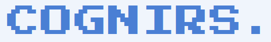

<p align="center">
  
  <br>
  <em>Synchronous cognitive testing and real-time prefrontal blood oxygenation monitoring.</em>
</p>

[](https://nodejs.org/)
[](https://vitejs.dev/)
[](https://cortivision.com/)

**COGNIRS** is a browser-based cognitive testing platform paired with real-time **fNIRS** recording. It runs a battery of executive function tasks while streaming time-locked `HbO` and `HbR` concentration data from a Cortivision PHOTON Cap C20 or a built-in 50 Hz simulator.

## Getting started

You need **Node.js 18+** and a Chromium-based browser (Chrome, Edge, or Brave).

### Windows (PowerShell)

1. Clone the repository and open the folder:
   ```powershell
   git clone https://github.com/BinaryWiz4rd/cognirs-dashboard.git
   cd cognirs-dashboard
   ```
2. Install the dependencies:
   ```powershell
   npm install
   ```
3. Start the dev server:
   ```powershell
   npm run dev
   ```
4. Open `http://localhost:3000` in your browser (Vite usually opens it automatically).

### Linux

1. Clone the repository and open the folder:
   ```bash
   git clone https://github.com/BinaryWiz4rd/cognirs-dashboard.git
   cd cognirs-dashboard
   ```
2. Install the dependencies:
   ```bash
   npm install
   ```
3. Start the dev server:
   ```bash
   npm run dev
   ```
4. Open `http://localhost:3000` in your browser.

If you are connecting a USB serial device on Linux and get a permission error on `/dev/ttyUSB0` or `/dev/ttyACM0`, add your user to the serial group (`sudo usermod -aG dialout $USER` on Debian/Ubuntu, or `uucp` on Arch/Fedora) and log back in.

### Production build

To build and preview the static bundle locally:

```bash
npm run build
npm run preview
```

## Running a session

1. Open **New session** from the top bar or home screen.
2. Fill in the participant ID, age, and group (`Neurotypical control` or `ADHD`).
3. Under **fNIRS device**, pick a source and click **Connect stream**:
   - **Cortivision (WebSocket)** — connects to `ws://127.0.0.1:5732` when the headset stream is active.
   - **50 Hz Simulator (Offline)** — generates synthetic 8-channel `HbO`/`HbR` data so you can run and test everything without hardware.
   - **WebSerial COM Port** — connects directly to a serial fNIRS device over USB.
4. Check the tasks you want to include in the battery and click **Begin session**.
5. When the battery finishes, the **Results** page shows per-task metrics and lets you download:
   - Behavioral trial data (`.csv`)
   - Timestamped `HbO`/`HbR` samples with task markers (`.csv`)
   - Full session dump (`.json`)

## Included tasks

- **Attention & inhibition:** Stroop Color–Word, Go / No-Go, Continuous Performance Test (`CPT-AX`)
- **Working memory:** N-Back (`0-Back`, `1-Back`, `2-Back`), Digit Span (`Forward`, `Backward`)
- **Executive function:** Trail Making Test (`Part A`, `Part B`), Reaction Time (`Simple`, `Choice`)