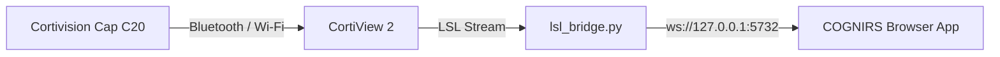

<p align="center">
  
  <br>
  <em>Synchronous cognitive testing and real-time prefrontal blood oxygenation monitoring.</em>
</p>

---

[](https://nodejs.org/)
[](https://vitejs.dev/)
[](https://www.python.org/)
[](https://cortivision.com/)

**COGNIRS** is a browser-based cognitive testing platform paired with real-time **fNIRS** recording. Built with Vanilla JavaScript (ES2022) and Vite, it runs a battery of executive function tasks while streaming time-locked `HbO` and `HbR` concentration data from a **Cortivision PHOTON Cap C20**.

---

## Architecture

Browsers cannot read Lab Streaming Layer (**LSL**) sockets directly, so a small Python script (`scripts/lsl_bridge.py`) forwards the LSL stream from **CortiView 2** to the web app over a local WebSocket (`ws://127.0.0.1:5732`). All incoming fNIRS samples and task markers are stamped against `performance.now()` on arrival to keep behavioral and hemodynamic events on a single monotonic clock.



---

## Setup

### Requirements
- **Node.js** `v18+`
- **Python** `3.10` – `3.12` (for the LSL bridge)
- **Browser:** Chrome, Edge, or another Chromium-based browser
- **Hardware:** Cortivision PHOTON Cap C20 with **CortiView 2** streaming over LSL *(not needed if running in simulation mode)*

### Installation

1. Clone the repo and install frontend dependencies:
```bash
git clone [https://github.com/BinaryWiz4rd/cognirs-dashboard.git](https://github.com/BinaryWiz4rd/cognirs-dashboard.git)
cd cognirs-dashboard
npm install
```

2. Create a Python virtual environment and install the bridge dependencies:

**Windows (PowerShell):**
```powershell
python -m venv .venv
.\.venv\Scripts\python.exe -m pip install -r scripts/requirements.txt
```

**macOS / Linux:**
```bash
python3 -m venv .venv
.venv/bin/pip install -r scripts/requirements.txt
```

---

## Running locally

Open two terminals side by side (for example, split terminals in VS Code).

### 1. Start the web app (Terminal 1)
```bash
npm run dev
```
Open the local URL shown in the terminal (usually `http://localhost:3000`).

### 2. Start the fNIRS stream (Terminal 2)

**With the Cortivision headset:**
1. Turn on the **Cortivision PHOTON Cap C20** and connect it in **CortiView 2**.
2. Check signal quality in CortiView 2 and enable **LSL streaming** (`HbO` / `HbR`).
3. Run the bridge:
   ```powershell
   # Windows
   .\.venv\Scripts\python.exe scripts/lsl_bridge.py
   ```
   ```bash
   # macOS / Linux
   .venv/bin/python scripts/lsl_bridge.py
   ```
   *(If CortiView 2 uses a custom LSL stream name, pass `--stream-name "StreamName"`).*
4. In COGNIRS, go to **Setup**, leave **Cortivision / LSL Bridge (WebSocket)** selected (`ws://127.0.0.1:5732`), and click **Connect stream**.

**Without hardware (testing / development):**
- **Simulated LSL bridge:** Run the Python bridge with `--simulate` to stream synthetic 50 Hz `HbO`/`HbR` data over WebSocket:
  ```powershell
  .\.venv\Scripts\python.exe scripts/lsl_bridge.py --simulate
  ```
- **In-browser simulator:** In **Setup**, switch the acquisition source to **50 Hz Simulator / WebSerial** and click **Connect stream** (no Python script needed).

---

## Included tasks & data export

- **Attention & inhibition:** Stroop Color–Word, Go / No-Go, Continuous Performance Test (`CPT-AX`)
- **Working memory:** N-Back (`0-Back`, `1-Back`, `2-Back`), Digit Span (`Forward`, `Backward`)
- **Executive function:** Trail Making Test (`Part A`, `Part B`), Reaction Time (`Simple`, `Choice`)

After finishing a session, the **Results** page summarizes behavioral metrics and exports synchronized **CSV** and **JSON** files with trial logs, raw `HbO`/`HbR` samples, and event markers.

---

## Repository structure

```text
cognirs-dashboard/
├── assets/                  # Documentation banner and diagrams
├── scripts/
│   ├── lsl_bridge.py        # LSL-to-WebSocket bridge for CortiView 2
│   └── requirements.txt     # Python dependencies (pylsl, websockets)
├── src/
│   ├── core/                # EventBus, Logger, StateManager
│   ├── fnirs/               # CortivisionAdapter, FNIRSDevice, FNIRSRecorder, FNIRSParser
│   ├── session/             # SessionManager & CSV/JSON exporter
│   ├── styles/              # CSS stylesheets
│   ├── tests/               # Cognitive tasks
│   ├── ui/                  # Home, Setup, Results pages & StatusBar
│   ├── utils/               # Timing, randomization, and stats helpers
│   ├── main.js              # Entry point
│   └── router.js            # View router
├── index.html
├── package.json
└── vite.config.js
```