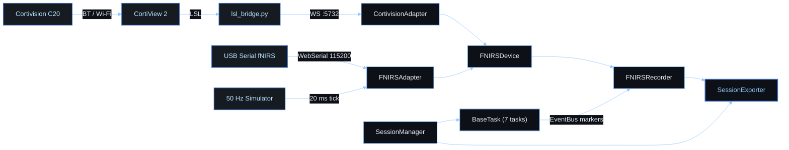

# COGNIRS - Technical Documentation

Architecture, streaming bridge, browser acquisition adapters, clock synchronization, cognitive task parameters, metrics, and export schemas. For setup and running a session, see [README.md](../README.md).

## Contents

- [Architecture & repository layout](#1-architecture--repository-layout)
- [LSL-to-WebSocket bridge (`scripts/lsl_bridge.py`)](#2-lsl-to-websocket-bridge-scriptslsl_bridgepy)
- [Browser fNIRS layer (`src/fnirs/`)](#3-browser-fnirs-layer-srcfnirs)
- [Core architecture & session lifecycle](#4-core-architecture--session-lifecycle)
- [Cognitive tasks (`src/tasks/`)](#5-cognitive-tasks-srctasks)
- [Metrics & data exports](#6-metrics--data-exports)
- [Verification & diagnostics](#7-verification--diagnostics)

## 1. Architecture & repository layout

COGNIRS decouples hardware acquisition from cognitive task execution through a central `EventBus` and a monotonic `performance.now()` timeline:



```text
cognirs-dashboard/
├── .github/
│   └── workflows/
│       └── ci.yml                 # GitHub Actions CI (Vitest, Vite build, Pytest)
├── docs/
│   └── TECHNICAL.md               # This file
├── scripts/
│   ├── lsl_bridge.py              # LSL-to-WebSocket bridge for CortiView 2
│   └── requirements.txt           # Python dependencies (pylsl, websockets)
├── src/
│   ├── core/
│   │   ├── EventBus.js            # Pub/sub event bus
│   │   ├── Logger.js              # Scoped console logger
│   │   └── StateManager.js        # Reactive application state store
│   ├── fnirs/
│   │   ├── CortivisionAdapter.js  # WebSocket client + clock offset smoother
│   │   ├── FNIRSAdapter.js        # WebSerial reader + 50 Hz simulator
│   │   ├── FNIRSDevice.js         # Transport controller + reconnect handling
│   │   ├── FNIRSParser.js         # 16-byte binary serial packet decoder
│   │   └── FNIRSRecorder.js       # Monotonic timeline + event marker recorder
│   ├── session/
│   │   ├── SessionManager.js      # Participant session & test queue runner
│   │   └── SessionExporter.js     # JSON, behavioral CSV, and fNIRS CSV builder
│   ├── tasks/
│   │   ├── BaseTask.js            # 3-phase lifecycle (instructions, demo, test)
│   │   ├── ContinuousPerformanceTask.js
│   │   ├── DigitSpanTask.js
│   │   ├── GoNoGoTask.js
│   │   ├── NBackTask.js
│   │   ├── ReactionTimeTask.js
│   │   ├── StroopTask.js
│   │   ├── TrailMakingTask.js
│   │   └── taskRegistry.js        # Centralized task metadata, factories, and metric builders
│   ├── ui/
│   │   ├── components/            # Header, StatusBar, Toast
│   │   └── pages/                 # HomePage, SetupPage, ResultsPage
│   ├── utils/
│   │   ├── DataUtils.js           # mean, std, median, movingAverage, normalize
│   │   ├── Random.js              # Seeded Park-Miller LCG
│   │   └── Timer.js               # performance.now() wrapper
│   ├── main.js                    # Application bootstrap
│   └── router.js                  # View router + active-session abort guard
├── tests/
│   ├── frontend/
│   │   └── tasks.test.js          # Vitest + jsdom behavioral task unit tests
│   └── bridge/
│       └── test_lsl_bridge.py     # Pytest suite for LSL XML mapping & WS framing
├── index.html
├── package.json
└── vite.config.js
```

## 2. LSL-to-WebSocket bridge (`scripts/lsl_bridge.py`)

Browsers cannot open Lab Streaming Layer (LSL) sockets directly because `liblsl` is a native C/C++ library. `scripts/lsl_bridge.py` resolves the LSL concentration stream published by **CortiView 2** (Cortivision PHOTON Cap C20) and forwards normalized JSON channel frames to the browser over a local WebSocket (`ws://127.0.0.1:5732` by default).

### Python environment

Requires **Python 3.10–3.12** (for prebuilt `pylsl` wheels).

1. Create and activate a virtual environment:
  - **Windows (PowerShell):**
     ```powershell
     py -3.12 -m venv .venv
     .\.venv\Scripts\Activate.ps1
     ```
- **Linux / macOS (Bash):**
     ```bash
     python3 -m venv .venv
     source .venv/bin/activate
     ```
2. Install dependencies and start the bridge:
   ```bash
   python -m pip install --upgrade pip
   python -m pip install -r scripts/requirements.txt
   python scripts/lsl_bridge.py
   ```

### CLI flags

| Flag | Default | Description |
| :--- | :--- | :--- |
| `--host` | `127.0.0.1` | WebSocket bind address |
| `--port` | `5732` | WebSocket port |
| `--stream-name` | `None` | Exact LSL stream name; if omitted, searches by `--stream-type` first, then falls back to names matching `corti`, `fnirs`, `nirs`, or `photon` |
| `--stream-type` | `NIRS` | LSL stream type passed to `resolve_byprop` |
| `--simulate` | `False` | Streams synthetic 50 Hz 8-channel `HbO`/`HbR` frames over WebSocket without `pylsl` or hardware |

### Channel layout & stream behavior

- **Channel discovery:** `parse_channel_layout()` inspects the LSL XML descriptor (`info.desc().child("channels")`) and matches `hbr`/`deoxy` tokens before `hbo`/`oxy` tokens in each channel's `label` and `type` fields to group them into logical channels `0..N-1`. If XML descriptors are absent, it falls back to interleaved pairs `[HbO_0, HbR_0, HbO_1, HbR_1, ...]`.
- **Polling & clock anchoring:** `inlet.pull_chunk(timeout=0.0)` is polled every 10 ms (100 Hz). LSL timestamps (`pylsl.local_clock()`) are anchored once at startup to Unix epoch milliseconds via `clock_offset_s = time.time() - local_clock()` to prevent OS wall-clock NTP step jumps mid-run.
- **Validation:** Non-finite values (`NaN`, `Inf`) are filtered out in `build_sample_frames()` prior to broadcast.
- **Reconnection:** If no LSL stream is found, the bridge retries every 2.0 s. If an active stream drops, it closes the inlet and retries after 1.0 s while keeping connected browser WebSocket clients open.

## 3. Browser fNIRS layer (`src/fnirs/`)

All three transports feed into `FNIRSDevice` (`src/fnirs/FNIRSDevice.js`), which manages the active adapter lifecycle and forwards normalized samples into `FNIRSRecorder` (`src/fnirs/FNIRSRecorder.js`).

| Mode | Adapter | Transport | Sample Rate | Channels |
| :--- | :--- | :--- | :--- | :--- |
| `cortivision` | `CortivisionAdapter.js` | WebSocket (`ws://127.0.0.1:5732`) | Device / LSL rate | Dynamic (C20 montage) |
| `simulator` | `FNIRSAdapter.js` | In-browser `setInterval` (20 ms) | 50 Hz | 8 (`0–7`) |
| `serial` | `FNIRSAdapter.js` + `FNIRSParser.js` | WebSerial (`115200 baud`) | Device rate | 8 (`0–7`) |

### Clock synchronization (`CortivisionAdapter.js`)

To align behavioral trial events with fNIRS samples on a single monotonic clock without OS wall-clock jumps or WebSocket batching jitter:

1. Upon WebSocket message arrival, `batchReceivedAt = performance.now()` is captured immediately.
2. `CortivisionAdapter` computes `candidateOffset = batchReceivedAt - maxDeviceTs` and updates `_streamOffsetMs` via an exponential moving average, $\alpha = 0.1$, resetting immediately if $\lvert \Delta \rvert > 1000\text{ ms}$.
3. Each sample's arrival time is calculated as `rawTs + _streamOffsetMs` and clamped via `Math.max(estimatedPerf, _lastReceivedAt)` so timestamps remain strictly non-decreasing across batched chunks.
4. Frames with missing or non-finite `hbo`/`hbr` values or non-integer `channel` indices are discarded.
5. `connect()` enforces a 5000 ms handshake timeout (`DEFAULT_CONNECT_TIMEOUT_MS`) and guards socket callbacks against stale socket instances if `disconnect()` and `connect()` are invoked back-to-back.

### Binary WebSerial packet format (`FNIRSParser.js`)

Used in `serial` mode when reading raw bytes from `navigator.serial`. Packets are fixed **16-byte** little-endian frames:

| Byte Offset | Size | Field | Encoding & Notes |
| :--- | :--- | :--- | :--- |
| `0` | 1 B | Sync byte | Must equal `0xAA` |
| `1` | 1 B | Packet length | Must equal `16` (`0x10`) |
| `2..5` | 4 B | `timestamp` | `uint32` little-endian, device ms |
| `6..9` | 4 B | `hbo` | `float32` little-endian, $\mu\text{mol/L}$ |
| `10..13` | 4 B | `hbr` | `float32` little-endian, $\mu\text{mol/L}$ |
| `14` | 1 B | `channel` | `uint8` channel index (`0–7`) |
| `15` | 1 B | Checksum | $\left(\sum_{i=0}^{14} \text{byte}[i]\right) \bmod 256$ |

On a length or checksum mismatch, `FNIRSParser` discards 1 byte and scans forward for the next `0xAA` sync byte. Its internal accumulation buffer is capped at **65,536 bytes (64 KB)**.

### Timeline recording & disconnect recovery (`FNIRSRecorder.js`)

- `FNIRSRecorder.start()` captures `_startPerfTime = performance.now()` and subscribes to `TEST_STARTED`, `TEST_ENDED`, `TEST_TRIAL_START`, and `TEST_TRIAL_END` on `eventBus`.
- Every ingested sample is stamped with `relativeTime = +(sample.receivedAt - _startPerfTime).toFixed(3)` (ms since recording start), and every task/trial event is recorded as a marker on the same timeline.
- If the fNIRS connection drops unexpectedly mid-session (`code !== 1000`), `FNIRSDevice._onClose()` inserts a `MANUAL` marker (`STREAM_INTERRUPTED`), emits `EVENTS.FNIRS_STREAM_INTERRUPTED`, and keeps `FNIRSRecorder` armed. Reconnecting inserts `STREAM_RECONNECTED` and resumes appending samples onto the same session timeline.

## 4. Core architecture & session lifecycle

- **`EventBus.js` (`src/core/`):** Pub/sub bus (`on`, `once`, `off`, `emit`, `clear`). `once()` returns an unsubscribe closure; `emit()` iterates over a shallow snapshot (`[...set]`) inside a `try/catch` block so handlers subscribing or unsubscribing mid-dispatch do not mutate the active delivery pass.
- **`StateManager.js` (`src/core/`):** Reactive store managing `{ participant, session, fnirsStatus, fnirsMode, fnirsUrl, currentTest, currentPage }`. `getState()` returns a shallow `Object.freeze()` copy; `reset()` restores initial defaults and notifies subscribers.
- **`router.js` (`src/`):** Listens to `EVENTS.NAVIGATE` and `EVENTS.SESSION_ENDED`, syncs `currentPage` in `StateManager`, and triggers `window.confirm` before aborting an active session if the user navigates away from `'test'` while `sessionManager.isActive()`.
- **`SessionManager.js` (`src/session/`):**
  - Generates session UUIDs via `crypto.randomUUID()`, falling back to a `Math.random()` UUIDv4 generator when served over plain HTTP on a LAN IP.
  - Aborts any running session if `begin()` is called while one is already active.
  - Runs queued tests sequentially with a 1200 ms inter-test pause, starts `fnirsDevice` recording on session start, stops it on completion, and emits `SESSION_ENDED`.

## 5. Cognitive tasks (`src/tasks/`)

All seven tasks extend `BaseTask.js` (and are registered in `taskRegistry.js`) and execute across three lifecycle phases:

1. **Instructions** - task rules and key bindings.
2. **Preview (`_renderDemo`)** - looping animated demonstration.
3. **Test** - 3-second countdown (`Get ready`), followed by active trials with all instructional chrome removed.

`BaseTask.unmount()` sets `_unmounted = true` and clears active demo/countdown timers so aborted tests cannot mutate detached DOM nodes or fire stale callbacks.

All stimulus generators use `SeededRandom` (`src/utils/Random.js`), which implements a Park-Miller LCG with fixed default seeds for reproducible trial sequences:

$$
s_{k+1} = (16807 \cdot s_k) \bmod (2^{31} - 1)
$$

| `testId` | Class | Default Parameters | Seed | Input | Implementation Notes |
| :--- | :--- | :--- | :--- | :--- | :--- |
| `stroop` | `StroopTask` | 24 trials, 33% congruent, 3000 ms display, 500 ms ITI | `42` | Mouse click (5 buttons) | Colors: `RED`, `BLUE`, `GREEN`, `YELLOW`, `PURPLE` |
| `go-no-go` | `GoNoGoTask` | 60 trials, 80% Go, 500 ms stim, 1000 ms response window, 800-1400 ms jittered ISI | `31` | `Space` (filled circle) | Withhold response on outline circle |
| `cpt` | `ContinuousPerformanceTask` | 100 trials, 22% `A -> X` targets, capped at $\lfloor \text{trials}/2 \rfloor$, 500 ms stim, 1000 ms ISI | `53` | `Space` (`X` after `A`) | Generator swaps accidental standalone `A -> X` pairs |
| `n-back` | `NBackTask` | 30 scored trials plus $n$ prime trials, 33% targets, 1500 ms stim, 500 ms ISI | `17` | `Space` (match $n$ back) | $n = 0$ matches `'X'`; includes fallback rules for $n \ge 3$ |
| `digit-span` | `DigitSpanTask` | `forward` or `backward`, max 14 trials, start span 3, 800 ms digit, 400 ms ISI | `61` | `0-9`, `Backspace`, `Enter` | 2-up / 1-down adaptive staircase (span range `2–9`) |
| `trail-making` | `TrailMakingTask` | Part `A` (`1..15`) or Part `B` (`1-A-2-B...`, 15 nodes) | `99` | Mouse click on nodes | Minimum Euclidean node spacing > 13% on 100×100 canvas |
| `reaction-time` | `ReactionTimeTask` | `simple` or `choice`, 20 trials, 1000–2800 ms random ITI, 3000 ms max stim | `7` | `Space` / `ArrowLeft` `ArrowRight` | Ignores `e.repeat`; early ITI presses log `falseStart: true` and `reactionTime: null` without consuming a trial |

## 6. Metrics & data exports

### Summary metrics (`src/tasks/taskRegistry.js` → `ResultsPage.js`)

- **Stroop:** overall accuracy, congruent accuracy, incongruent accuracy, mean congruent/incongruent RT, interference effect — $\text{RT}(\text{incongruent}) - \text{RT}(\text{congruent})$.
- **Go / No-Go:** Go accuracy, commission errors (No-Go presses), omission errors (missed Go), correct rejections, mean Go RT, Go RT SD.
- **CPT-AX:** hit rate, false alarm rate, mean hit RT, accuracy across early / middle / late thirds (vigilance decrement).
- **N-Back:** hit rate, false alarm rate, misses, sensitivity $d^{\prime} = z(\text{HR}) - z(\text{FAR})$ using the Abramowitz & Stegun rational inverse normal approximation, with rates clamped to $[0.01, 0.99]$, mean hit RT, hit RT SD.
- **Digit Span:** max span reached, trials correct, mean span.
- **Reaction Time:** accuracy, mean RT, median RT, RT SD, false starts, timeout count.
- **Trail Making:** total completion time (s), sequence error count.

### Exported files (`src/session/SessionExporter.js`)

`SessionExporter` defers `URL.revokeObjectURL()` by 1000 ms after triggering the download anchor so slower disks finish reading the Blob before revocation. `DataUtils.normalize()` computes min/max in a single `for` loop rather than `Math.min(...arr)` so long recordings (150k+ samples) do not overflow the JS argument stack.

#### 1. `cognirs_session_<id8>.json`

Full raw session dump containing `id`, `startTime`, `endTime`, `participant`, `tests`, and `fnirs`.

#### 2. `cognirs_behavioral_<id8>.csv`

One row per trial across all completed tasks. Inapplicable boolean fields export as empty cells (`''`), booleans as `1`/`0`, and unresponded or false-start reaction times as `-1`:

```csv
sessionId,participantId,group,sex,age,testId,testName,variant,nLevel,trialIndex,correct,reactionTime_ms,timedOut,falseStart,itiElapsedMs,errors,isTarget,isGo,congruent,span,hit,miss,falseAlarm,commission,omission,correctRejection,key,side,letter,response
```

- **Metadata:** `sessionId`, `participantId`, `group`, `sex`, `age`, `testId`, `testName`, `variant`, `nLevel`, `trialIndex`
- **Timing & accuracy:** `correct`, `reactionTime_ms`, `timedOut`, `falseStart`, `itiElapsedMs`, `errors`
- **Task-specific flags & responses:** `isTarget`, `isGo`, `congruent`, `span`, `hit`, `miss`, `falseAlarm`, `commission`, `omission`, `correctRejection`, `key`, `side`, `letter`, `response`

#### 3. `cognirs_fnirs_<id8>.csv`

Time-sorted stream of concentration samples with interleaved `# MARKER` comment rows:

```csv
relativeTime_ms,deviceTimestamp_ms,channel,hbo,hbr
104.210,1732384120104.200,0,0.512340,0.298110
# MARKER,TRIAL_START,105.000,"{""testId"":""stroop"",""trial"":{...}}"
```

## 7. Verification & diagnostics

- **Automated unit test suites** (run via GitHub Actions on every push, or locally from repo root):
  ```bash
  npm test     # Headless Vitest + jsdom behavioral task suite (7 tasks)
  pytest -v    # LSL XML channel mapping, sample framing & WebSocket broadcast tests
  ```
- **End-to-end offline pipeline check:** Start `npm run dev` (or `python scripts/lsl_bridge.py --simulate` for the WebSocket path), select **50 Hz Simulator (Offline)** or **Cortivision (WebSocket)** in **New session**, run a short task battery, and inspect the downloaded `.csv` and `.json` exports alongside Chromium DevTools Console logs (`Logger.js`).
